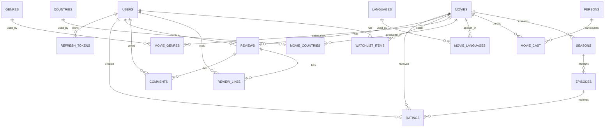

> Архів матеріалів моноліту до виділення Auth/Catalog. Актуальний запуск, архітектура та перевірки: [кореневий README](../README.md) і [docs/lab-verification.md](../docs/lab-verification.md).

# Проектирование базы данных CinemaCity

Документ описывает структуру базы данных для CinemaCity на основе `Documentation/Doc.md`.
Основная СУБД: PostgreSQL. Кеш не используется, все рабочие данные читаются и записываются напрямую в PostgreSQL.

---

## 1. Цель базы данных

База данных должна хранить:

- пользователей, роли, вход через email/password и Google OAuth;
- refresh-токены для авторизации;
- каталог фильмов и сериалов;
- жанры, страны, языки и участников производства;
- сезоны и эпизоды сериалов;
- оценки фильмов и эпизодов;
- рецензии, комментарии и лайки рецензий;
- watchlist и список просмотренного;
- служебные поля для модерации и мягкого удаления контента.

---

## 2. Общие решения проектирования

- Идентификаторы основных сущностей: `uuid`.
- Временные поля: `timestamp with time zone`.
- Денежные типы не используются.
- Средний рейтинг фильма хранится в `movies.average_rating`, количество оценок в `movies.ratings_count`.
- После добавления, изменения или удаления оценки рейтинг пересчитывается service-методом или транзакционной процедурой.
- Удаление фильмов и рецензий мягкое: через `is_deleted` и `deleted_at`.
- Для справочников используются отдельные таблицы: `genres`, `countries`, `languages`.
- Связи многие-ко-многим оформлены через таблицы-связки.
- Refresh token хранится в БД, access token в БД не хранится.

---

## 3. ER-схема



---

## 4. Перечисления

### `user_role`

| Значение | Описание |
|---|---|
| `User` | Обычный пользователь |
| `Admin` | Администратор |

### `content_type`

| Значение | Описание |
|---|---|
| `Movie` | Фильм |
| `Series` | Сериал |

### `credit_type`

| Значение | Описание |
|---|---|
| `Actor` | Актер |
| `Director` | Режиссер |
| `Writer` | Сценарист |
| `Producer` | Продюсер |

### `review_status`

| Значение | Описание |
|---|---|
| `Pending` | Ожидает модерации |
| `Approved` | Одобрена |
| `Rejected` | Отклонена |

### `watchlist_status`

| Значение | Описание |
|---|---|
| `Watchlist` | Пользователь хочет посмотреть |
| `Watched` | Пользователь уже посмотрел |

---

## 5. Таблицы

### `users`

Хранит аккаунты пользователей.

| Поле | Тип | Ограничения | Описание |
|---|---|---|---|
| `id` | `uuid` | PK | Идентификатор пользователя |
| `username` | `varchar(30)` | NOT NULL, UNIQUE | Имя пользователя |
| `email` | `varchar(255)` | NOT NULL, UNIQUE | Email |
| `password_hash` | `text` | NULL | Хеш пароля, `NULL` для OAuth-аккаунтов |
| `google_id` | `varchar(255)` | UNIQUE, NULL | Идентификатор Google OAuth |
| `avatar_url` | `text` | NULL | Ссылка на аватар |
| `role` | `user_role` | NOT NULL, default `User` | Роль |
| `is_email_confirmed` | `boolean` | NOT NULL, default `false` | Подтвержден ли email |
| `failed_login_attempts` | `integer` | NOT NULL, default `0` | Количество неудачных входов |
| `lockout_end_at` | `timestamptz` | NULL | Блокировка после неудачных входов |
| `created_at` | `timestamptz` | NOT NULL | Дата создания |
| `updated_at` | `timestamptz` | NULL | Дата обновления |

### `refresh_tokens`

Хранит refresh-токены для JWT-авторизации.

| Поле | Тип | Ограничения | Описание |
|---|---|---|---|
| `id` | `uuid` | PK | Идентификатор токена |
| `user_id` | `uuid` | FK -> `users.id`, NOT NULL | Владелец токена |
| `token_hash` | `text` | NOT NULL, UNIQUE | Хеш refresh token |
| `expires_at` | `timestamptz` | NOT NULL | Срок действия |
| `revoked_at` | `timestamptz` | NULL | Дата отзыва |
| `created_at` | `timestamptz` | NOT NULL | Дата создания |

### `movies`

Хранит фильмы и сериалы.

| Поле | Тип | Ограничения | Описание |
|---|---|---|---|
| `id` | `uuid` | PK | Идентификатор фильма или сериала |
| `title` | `varchar(255)` | NOT NULL | Название |
| `original_title` | `varchar(255)` | NULL | Оригинальное название |
| `content_type` | `content_type` | NOT NULL | `Movie` или `Series` |
| `release_year` | `integer` | NOT NULL | Год выхода |
| `duration` | `integer` | NULL | Длительность в минутах |
| `description` | `text` | NULL | Описание |
| `poster_url` | `text` | NULL | Постер |
| `backdrop_url` | `text` | NULL | Фоновое изображение |
| `trailer_youtube_id` | `varchar(64)` | NULL | YouTube ID трейлера |
| `average_rating` | `numeric(3,1)` | NOT NULL, default `0` | Средняя оценка |
| `ratings_count` | `integer` | NOT NULL, default `0` | Количество оценок |
| `is_deleted` | `boolean` | NOT NULL, default `false` | Мягкое удаление |
| `deleted_at` | `timestamptz` | NULL | Дата удаления |
| `created_at` | `timestamptz` | NOT NULL | Дата создания |
| `updated_at` | `timestamptz` | NULL | Дата обновления |

### `genres`

Справочник жанров.

| Поле | Тип | Ограничения | Описание |
|---|---|---|---|
| `id` | `integer` | PK | Идентификатор жанра |
| `name` | `varchar(100)` | NOT NULL, UNIQUE | Название |
| `slug` | `varchar(100)` | NOT NULL, UNIQUE | URL-идентификатор |

### `movie_genres`

Связь фильмов и жанров.

| Поле | Тип | Ограничения | Описание |
|---|---|---|---|
| `movie_id` | `uuid` | PK, FK -> `movies.id` | Фильм |
| `genre_id` | `integer` | PK, FK -> `genres.id` | Жанр |

### `countries`

Справочник стран производства.

| Поле | Тип | Ограничения | Описание |
|---|---|---|---|
| `id` | `integer` | PK | Идентификатор страны |
| `name` | `varchar(100)` | NOT NULL, UNIQUE | Название |
| `code` | `varchar(2)` | UNIQUE, NULL | ISO-код страны |

### `movie_countries`

Связь фильмов и стран.

| Поле | Тип | Ограничения | Описание |
|---|---|---|---|
| `movie_id` | `uuid` | PK, FK -> `movies.id` | Фильм |
| `country_id` | `integer` | PK, FK -> `countries.id` | Страна |

### `languages`

Справочник языков.

| Поле | Тип | Ограничения | Описание |
|---|---|---|---|
| `id` | `integer` | PK | Идентификатор языка |
| `name` | `varchar(100)` | NOT NULL, UNIQUE | Название |
| `code` | `varchar(8)` | UNIQUE, NULL | Код языка |

### `movie_languages`

Связь фильмов и языков.

| Поле | Тип | Ограничения | Описание |
|---|---|---|---|
| `movie_id` | `uuid` | PK, FK -> `movies.id` | Фильм |
| `language_id` | `integer` | PK, FK -> `languages.id` | Язык |

### `persons`

Хранит актеров, режиссеров, сценаристов и других участников.

| Поле | Тип | Ограничения | Описание |
|---|---|---|---|
| `id` | `uuid` | PK | Идентификатор персоны |
| `full_name` | `varchar(255)` | NOT NULL | Полное имя |
| `birth_date` | `date` | NULL | Дата рождения |
| `birth_place` | `varchar(255)` | NULL | Место рождения |
| `bio` | `text` | NULL | Биография |
| `photo_url` | `text` | NULL | Фото |
| `created_at` | `timestamptz` | NOT NULL | Дата создания |
| `updated_at` | `timestamptz` | NULL | Дата обновления |

### `movie_cast`

Связь фильмов и персон.

| Поле | Тип | Ограничения | Описание |
|---|---|---|---|
| `id` | `uuid` | PK | Идентификатор записи |
| `movie_id` | `uuid` | FK -> `movies.id`, NOT NULL | Фильм |
| `person_id` | `uuid` | FK -> `persons.id`, NOT NULL | Персона |
| `credit_type` | `credit_type` | NOT NULL | Тип участия |
| `role_name` | `varchar(255)` | NULL | Имя персонажа для актеров |
| `sort_order` | `integer` | NOT NULL, default `0` | Порядок отображения |

### `seasons`

Хранит сезоны сериалов.

| Поле | Тип | Ограничения | Описание |
|---|---|---|---|
| `id` | `uuid` | PK | Идентификатор сезона |
| `series_id` | `uuid` | FK -> `movies.id`, NOT NULL | Сериал |
| `season_number` | `integer` | NOT NULL | Номер сезона |
| `title` | `varchar(255)` | NULL | Название сезона |
| `description` | `text` | NULL | Описание |
| `release_year` | `integer` | NULL | Год выхода |

### `episodes`

Хранит серии внутри сезона.

| Поле | Тип | Ограничения | Описание |
|---|---|---|---|
| `id` | `uuid` | PK | Идентификатор эпизода |
| `season_id` | `uuid` | FK -> `seasons.id`, NOT NULL | Сезон |
| `episode_number` | `integer` | NOT NULL | Номер эпизода |
| `title` | `varchar(255)` | NOT NULL | Название |
| `air_date` | `date` | NULL | Дата выхода |
| `duration` | `integer` | NULL | Длительность в минутах |
| `average_rating` | `numeric(3,1)` | NOT NULL, default `0` | Средняя оценка эпизода |
| `ratings_count` | `integer` | NOT NULL, default `0` | Количество оценок |

### `ratings`

Хранит оценки фильмов и эпизодов.

| Поле | Тип | Ограничения | Описание |
|---|---|---|---|
| `id` | `uuid` | PK | Идентификатор оценки |
| `user_id` | `uuid` | FK -> `users.id`, NOT NULL | Автор оценки |
| `movie_id` | `uuid` | FK -> `movies.id`, NULL | Фильм или сериал |
| `episode_id` | `uuid` | FK -> `episodes.id`, NULL | Эпизод |
| `score` | `numeric(3,1)` | NOT NULL, CHECK 1..10 | Оценка |
| `created_at` | `timestamptz` | NOT NULL | Дата создания |
| `updated_at` | `timestamptz` | NULL | Дата обновления |

Ограничение: должна быть заполнена ровно одна цель оценки: `movie_id` или `episode_id`.

### `reviews`

Хранит рецензии на фильмы и сериалы.

| Поле | Тип | Ограничения | Описание |
|---|---|---|---|
| `id` | `uuid` | PK | Идентификатор рецензии |
| `user_id` | `uuid` | FK -> `users.id`, NOT NULL | Автор |
| `movie_id` | `uuid` | FK -> `movies.id`, NOT NULL | Фильм или сериал |
| `content` | `text` | NOT NULL | Текст рецензии |
| `is_spoiler` | `boolean` | NOT NULL, default `false` | Есть ли спойлеры |
| `likes_count` | `integer` | NOT NULL, default `0` | Количество лайков |
| `status` | `review_status` | NOT NULL, default `Pending` | Статус модерации |
| `rejection_reason` | `text` | NULL | Причина отклонения |
| `is_deleted` | `boolean` | NOT NULL, default `false` | Мягкое удаление |
| `deleted_at` | `timestamptz` | NULL | Дата удаления |
| `created_at` | `timestamptz` | NOT NULL | Дата создания |
| `updated_at` | `timestamptz` | NULL | Дата обновления |

### `comments`

Хранит комментарии к рецензиям.

| Поле | Тип | Ограничения | Описание |
|---|---|---|---|
| `id` | `uuid` | PK | Идентификатор комментария |
| `review_id` | `uuid` | FK -> `reviews.id`, NOT NULL | Рецензия |
| `user_id` | `uuid` | FK -> `users.id`, NOT NULL | Автор |
| `content` | `text` | NOT NULL | Текст комментария |
| `is_deleted` | `boolean` | NOT NULL, default `false` | Мягкое удаление |
| `created_at` | `timestamptz` | NOT NULL | Дата создания |
| `updated_at` | `timestamptz` | NULL | Дата обновления |

### `review_likes`

Хранит лайки рецензий.

| Поле | Тип | Ограничения | Описание |
|---|---|---|---|
| `user_id` | `uuid` | PK, FK -> `users.id` | Пользователь |
| `review_id` | `uuid` | PK, FK -> `reviews.id` | Рецензия |
| `created_at` | `timestamptz` | NOT NULL | Дата лайка |

### `watchlist_items`

Хранит фильмы в watchlist и просмотренные фильмы.

| Поле | Тип | Ограничения | Описание |
|---|---|---|---|
| `id` | `uuid` | PK | Идентификатор записи |
| `user_id` | `uuid` | FK -> `users.id`, NOT NULL | Пользователь |
| `movie_id` | `uuid` | FK -> `movies.id`, NOT NULL | Фильм |
| `status` | `watchlist_status` | NOT NULL, default `Watchlist` | Статус |
| `added_at` | `timestamptz` | NOT NULL | Дата добавления |
| `updated_at` | `timestamptz` | NULL | Дата изменения статуса |

---

## 6. Основные связи

| Связь | Тип | Реализация |
|---|---|---|
| Пользователь -> оценки | 1:N | `ratings.user_id` |
| Пользователь -> рецензии | 1:N | `reviews.user_id` |
| Пользователь -> watchlist | 1:N | `watchlist_items.user_id` |
| Фильм -> оценки | 1:N | `ratings.movie_id` |
| Фильм -> рецензии | 1:N | `reviews.movie_id` |
| Фильм -> жанры | M:N | `movie_genres` |
| Фильм -> страны | M:N | `movie_countries` |
| Фильм -> языки | M:N | `movie_languages` |
| Фильм -> участники | M:N | `movie_cast` |
| Сериал -> сезоны | 1:N | `seasons.series_id` |
| Сезон -> эпизоды | 1:N | `episodes.season_id` |
| Эпизод -> оценки | 1:N | `ratings.episode_id` |
| Рецензия -> комментарии | 1:N | `comments.review_id` |
| Рецензия -> лайки | 1:N | `review_likes.review_id` |

---

## 7. Уникальные ограничения и проверки

| Таблица | Ограничение | Назначение |
|---|---|---|
| `users` | UNIQUE `email` | Нельзя зарегистрировать один email дважды |
| `users` | UNIQUE `username` | Уникальные имена пользователей |
| `users` | UNIQUE `google_id` WHERE `google_id IS NOT NULL` | Один Google-аккаунт на одного пользователя |
| `refresh_tokens` | UNIQUE `token_hash` | Защита от дубликатов токенов |
| `movie_genres` | PK (`movie_id`, `genre_id`) | Жанр не дублируется у фильма |
| `movie_countries` | PK (`movie_id`, `country_id`) | Страна не дублируется у фильма |
| `movie_languages` | PK (`movie_id`, `language_id`) | Язык не дублируется у фильма |
| `seasons` | UNIQUE (`series_id`, `season_number`) | Номер сезона уникален внутри сериала |
| `episodes` | UNIQUE (`season_id`, `episode_number`) | Номер эпизода уникален внутри сезона |
| `ratings` | UNIQUE (`user_id`, `movie_id`) WHERE `movie_id IS NOT NULL` | Одна оценка пользователя на фильм |
| `ratings` | UNIQUE (`user_id`, `episode_id`) WHERE `episode_id IS NOT NULL` | Одна оценка пользователя на эпизод |
| `ratings` | CHECK `score >= 1 AND score <= 10` | Оценка только от 1 до 10 |
| `ratings` | CHECK ровно одной цели | Нельзя оценить фильм и эпизод одной записью |
| `reviews` | UNIQUE (`user_id`, `movie_id`) | Одна рецензия пользователя на фильм |
| `review_likes` | PK (`user_id`, `review_id`) | Один лайк пользователя на рецензию |
| `watchlist_items` | UNIQUE (`user_id`, `movie_id`) | Фильм не дублируется в списке пользователя |

---

## 8. Индексы

### Поиск и каталог

| Индекс | Назначение |
|---|---|
| `idx_movies_title_trgm` на `movies.title` | Быстрый поиск по названию через `ILIKE` или trigram |
| `idx_movies_original_title_trgm` на `movies.original_title` | Поиск по оригинальному названию |
| `idx_movies_rating` на `average_rating DESC, ratings_count DESC` | Топ-рейтинг |
| `idx_movies_release_year` на `release_year` | Фильтр по году |
| `idx_movies_content_type` на `content_type` | Фильтр фильм/сериал |
| `idx_movies_not_deleted` partial WHERE `is_deleted = false` | Каталог без удаленных фильмов |

### Пользовательские действия

| Индекс | Назначение |
|---|---|
| `idx_ratings_user_id` | Быстро получить оценки пользователя |
| `idx_ratings_movie_id` | Быстро пересчитать рейтинг фильма |
| `idx_reviews_movie_status` на `movie_id, status` | Получить одобренные рецензии фильма |
| `idx_comments_review_id` | Получить комментарии рецензии |
| `idx_watchlist_user_status` на `user_id, status` | Watchlist и просмотренные |

### Админ-панель

| Индекс | Назначение |
|---|---|
| `idx_reviews_status_created_at` | Очередь модерации |
| `idx_persons_full_name_trgm` | Поиск персон |
| `idx_movie_cast_person_id` | Фильмография персоны |

---

## 9. Правила бизнес-логики на уровне БД и сервиса

### Регистрация и вход

1. `email` и `username` должны быть уникальными.
2. Для OAuth-пользователя `password_hash` может быть `NULL`.
3. Refresh token хранится как хеш в `refresh_tokens`.
4. При logout у токена заполняется `revoked_at`.

### Оценки

1. Пользователь может поставить только одну оценку одному фильму.
2. Пользователь может поставить только одну оценку одному эпизоду.
3. После изменения оценки пересчитываются:
   - `movies.average_rating`;
   - `movies.ratings_count`;
   - `episodes.average_rating`;
   - `episodes.ratings_count`.
4. Если пользователь поставил оценку фильму, запись в `watchlist_items` может автоматически перейти в статус `Watched`.

### Рецензии

1. Пользователь может написать одну рецензию на один фильм.
2. Новая рецензия создается со статусом `Pending`.
3. В публичной части показываются только рецензии со статусом `Approved` и `is_deleted = false`.
4. Лайк рецензии реализуется как toggle через `review_likes`.
5. `reviews.likes_count` обновляется при добавлении или удалении записи из `review_likes`.

### Фильмы и сериалы

1. Фильм не удаляется физически, а скрывается через `is_deleted = true`.
2. `seasons` допустимы только для записей `movies.content_type = 'Series'`.
3. `episodes` всегда принадлежат сезону.
4. Рекомендации строятся по пересечению жанров через `movie_genres`.

---

## 10. Минимальный порядок создания таблиц

1. Enum-типы: `user_role`, `content_type`, `credit_type`, `review_status`, `watchlist_status`.
2. Справочники: `genres`, `countries`, `languages`.
3. Основные таблицы: `users`, `movies`, `persons`.
4. Связки каталога: `movie_genres`, `movie_countries`, `movie_languages`, `movie_cast`.
5. Сериальная структура: `seasons`, `episodes`.
6. Авторизация: `refresh_tokens`.
7. Пользовательский контент: `ratings`, `reviews`, `comments`, `review_likes`, `watchlist_items`.
8. Индексы и partial unique indexes.

---

## 11. Пример PostgreSQL DDL для ключевых таблиц

```sql
CREATE TYPE user_role AS ENUM ('User', 'Admin');
CREATE TYPE content_type AS ENUM ('Movie', 'Series');
CREATE TYPE credit_type AS ENUM ('Actor', 'Director', 'Writer', 'Producer');
CREATE TYPE review_status AS ENUM ('Pending', 'Approved', 'Rejected');
CREATE TYPE watchlist_status AS ENUM ('Watchlist', 'Watched');

CREATE TABLE users (
    id uuid PRIMARY KEY,
    username varchar(30) NOT NULL UNIQUE,
    email varchar(255) NOT NULL UNIQUE,
    password_hash text NULL,
    google_id varchar(255) NULL UNIQUE,
    avatar_url text NULL,
    role user_role NOT NULL DEFAULT 'User',
    is_email_confirmed boolean NOT NULL DEFAULT false,
    failed_login_attempts integer NOT NULL DEFAULT 0,
    lockout_end_at timestamptz NULL,
    created_at timestamptz NOT NULL,
    updated_at timestamptz NULL
);

CREATE TABLE movies (
    id uuid PRIMARY KEY,
    title varchar(255) NOT NULL,
    original_title varchar(255) NULL,
    content_type content_type NOT NULL,
    release_year integer NOT NULL,
    duration integer NULL,
    description text NULL,
    poster_url text NULL,
    backdrop_url text NULL,
    trailer_youtube_id varchar(64) NULL,
    average_rating numeric(3,1) NOT NULL DEFAULT 0,
    ratings_count integer NOT NULL DEFAULT 0,
    is_deleted boolean NOT NULL DEFAULT false,
    deleted_at timestamptz NULL,
    created_at timestamptz NOT NULL,
    updated_at timestamptz NULL
);

CREATE TABLE ratings (
    id uuid PRIMARY KEY,
    user_id uuid NOT NULL REFERENCES users(id) ON DELETE CASCADE,
    movie_id uuid NULL REFERENCES movies(id) ON DELETE CASCADE,
    episode_id uuid NULL,
    score numeric(3,1) NOT NULL CHECK (score >= 1 AND score <= 10),
    created_at timestamptz NOT NULL,
    updated_at timestamptz NULL,
    CHECK (
        (movie_id IS NOT NULL AND episode_id IS NULL)
        OR
        (movie_id IS NULL AND episode_id IS NOT NULL)
    )
);
```

Полный DDL удобнее генерировать через миграции Entity Framework Core 10, чтобы C#-модели и схема PostgreSQL оставались синхронизированными.
