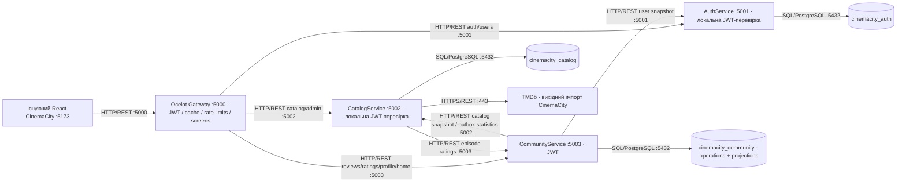

# Композиція CinemaCity після ЛР2

CommunityService винесено в окремий процес з власною БД. Моноліт залишається доступним окремо для режиму ЛР0. Бази можуть бути на одному PostgreSQL, але підключення й схеми належать окремим застосункам. Зовнішній порт PostgreSQL у Docker за замовчуванням 5433, усередині мережі — 5432.

