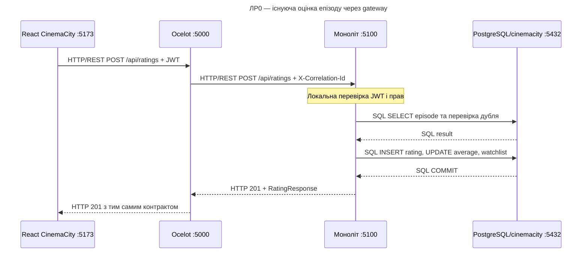

# Послідовність ЛР0: оцінити епізод у вихідному моноліті

Режим `Gateway:Mode=Monolith`, `Services:Enabled=false`. JWT перевіряється монолітом. Усі внутрішні виклики модулів та EF Core залишаються локальними. База — вихідний CinemaCity; в оновленій перехідній схемі посилання збережені у власних projections.

