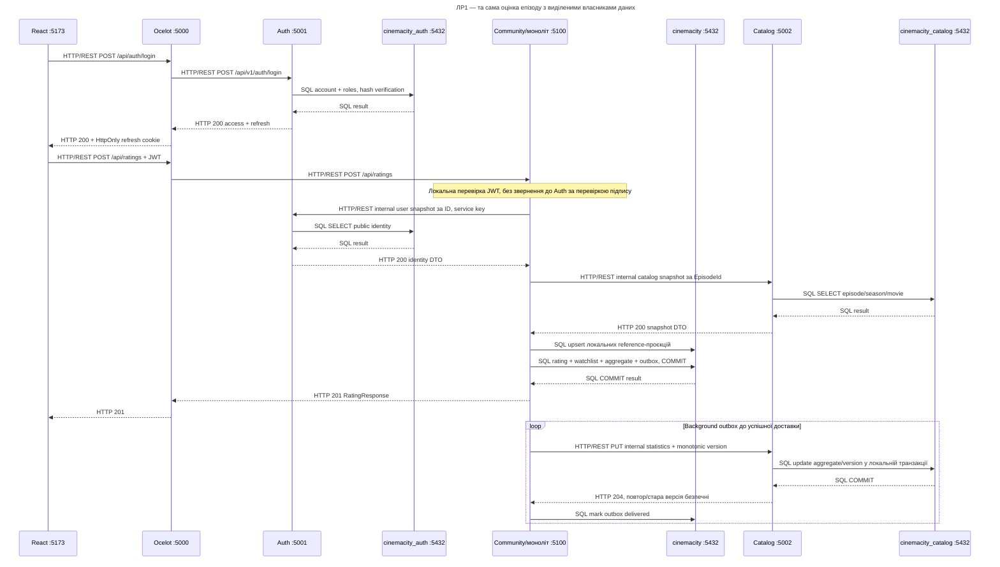

# Послідовність ЛР1: той самий сценарій після виділення

Після входу Auth видає JWT. Оцінка залишається у Community, метадані епізоду належать Catalog. Нові мережеві виклики видимі явно; бази не поєднуються JOIN. Outbox дає повторну доставку, а не спільну транзакцію трьох БД.

